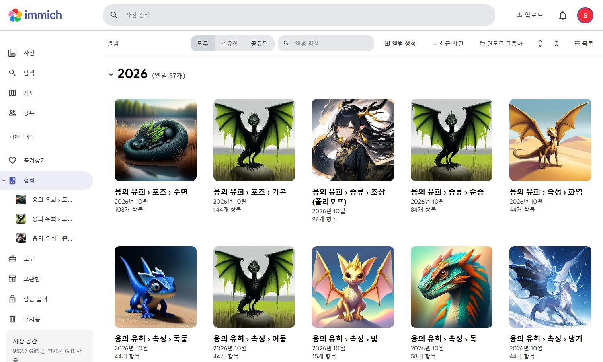
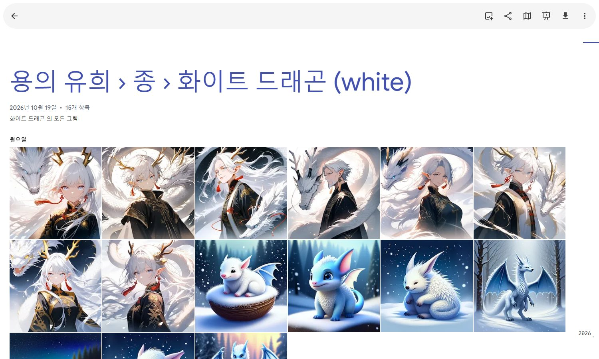
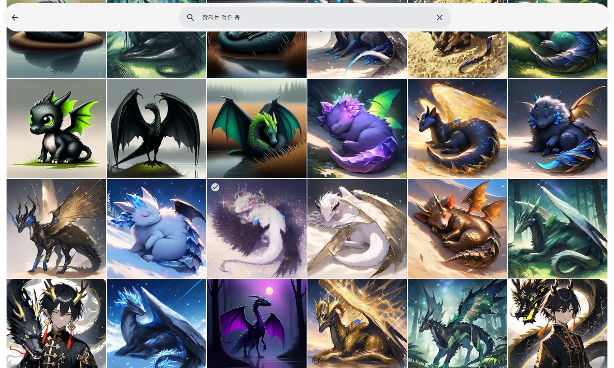
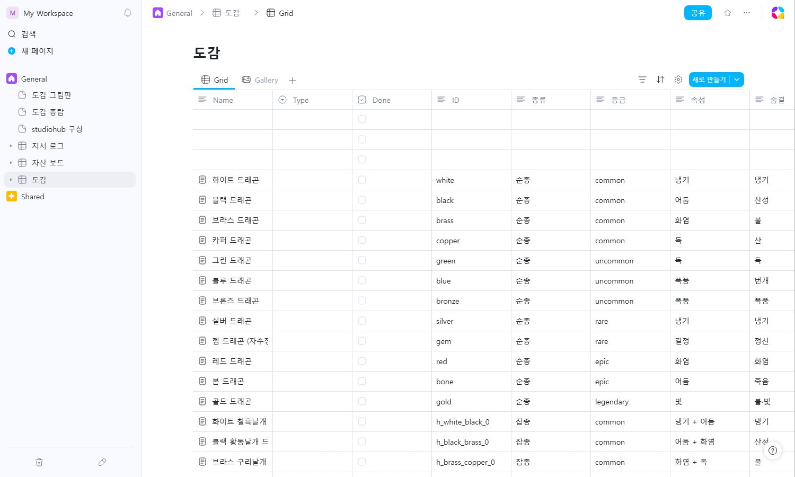
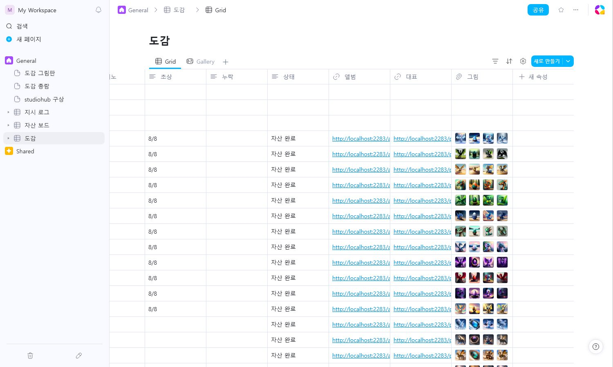
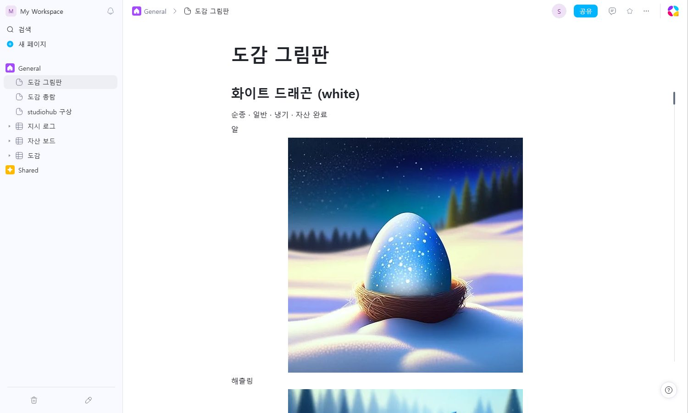
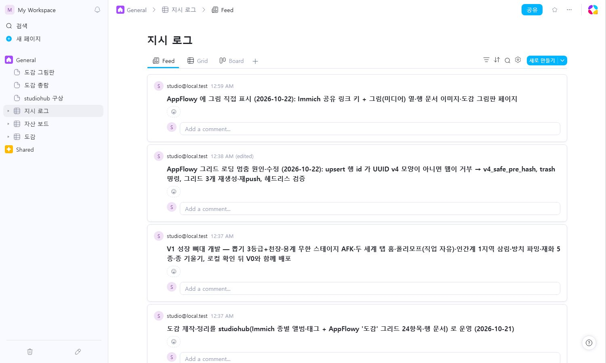

# studiohub

> Self-hosted **Immich** (image library + CLIP search) and **AppFlowy Cloud** (grids, documents) as a game-dev workbench, glued together by a dependency-free Python CLI. Korean docs below.

로컬에 띄운 [Immich](https://github.com/immich-app/immich)(그림 라이브러리·자연어 검색)와 [AppFlowy Cloud](https://github.com/AppFlowy-IO/AppFlowy-Cloud)(보드·문서)에 **파일을 밀어 넣는** 명령줄 도구입니다. 정본은 항상 로컬 파일이고, 두 서비스는 보고·찾고·쓰는 작업대입니다.

```
<자산 폴더>/<프로젝트>/<슬롯>/…   ──immich sync──▶  Immich 앨범·태그     ──immich find──▶  검색·유사 이미지
지시 로그 (Markdown 표)          ──appflowy push-directives──▶  AppFlowy 그리드
도감 문서 (Markdown)            ──dex board / gallery──▶  AppFlowy 그리드(썸네일 열)·그림판 페이지
```

## 화면

수집형 드래곤 게임의 그림 348장을 넣은 모습입니다.

| | |
|---|---|
| **Immich 분류 앨범** — `dex albums` 가 종류·단계·포즈·속성·등급·서식지·종별로 57개 앨범을 만든다  | **종별 앨범** — 한 종의 단계·포즈·초상이 한곳에  |
| **자연어 검색** — 다국어 CLIP 으로 "잠자는 검은 용"  | **AppFlowy 도감 그리드** — 게임 데이터·자산 현황이 행으로  |
| **그림(미디어) 열** — Immich 공유 링크 썸네일이 셀에 바로 보인다  | **도감 그림판 페이지** — 항목마다 단계별 그림을 이미지 블록으로  |
| **지시 로그 그리드** — Markdown 표가 행으로 (upsert)  | |

## 요구 사항

- Python 3.11 이상 (표준 라이브러리만 씁니다)
- Docker Desktop(또는 Docker Engine) — Immich·AppFlowy 를 띄울 때. 스택 스크립트는 [local-services/](local-services/README.md)
- Immich API 키, AppFlowy 일반 계정(이메일·비밀번호)

## 설치

```bash
git clone https://github.com/Zephyras/studiohub.git
cd studiohub
cp studiohub.env.example studiohub.env   # 값을 채운다
python studiohub.py doctor               # 연결 점검
```

`studiohub.env` 는 git 에 들어가지 않습니다. 같은 키를 환경 변수로 주면 환경 변수가 우선합니다.

| 키 | 뜻 |
|---|---|
| `IMMICH_URL`, `IMMICH_API_KEY` | Immich 주소(기본 `http://localhost:2283`)와 API 키(계정 설정 → API 키) |
| `APPFLOWY_URL`, `APPFLOWY_EMAIL`, `APPFLOWY_PASSWORD`, `APPFLOWY_WORKSPACE` | AppFlowy 주소(기본 `http://localhost:8070`)와 계정. 워크스페이스는 이름 또는 id, 비우면 첫 번째 |
| `STUDIOHUB_ASSETS_REGISTRY` | 자산 레지스트리 JSON 경로 (아래) |
| `STUDIOHUB_STATE_DIR` | 동기화 장부·토큰 캐시 폴더 (기본 `.state/`) |
| `STUDIOHUB_VAULT` | 지시 로그 Markdown 이 있는 폴더 |
| `STUDIOHUB_DEX_DATA` | 도감 프로필이 읽는 게임 데이터 폴더 |

### 자산 레지스트리

여러 프로젝트의 산출물 폴더를 하나의 JSON 으로 가리킵니다. 경로는 여기에만 적고, 도구는 이 파일을 읽습니다.

```json
{
  "root": "D:/assets",
  "slots": { "concept": "컨셉", "calibration": "실험", "library": "승인본", "inbox": "후보", "export": "내보내기" },
  "projects": { "my-game": { "kind": "game" } }
}
```

폴더 구조는 `<root>/<project>/<slot>/…` 입니다. 그림 옆에 같은 이름의 `.json` 사이드카가 있으면 `kind`·`key`·`note` 를 태그와 설명에 씁니다.

## 명령

프로젝트 이름은 레지스트리의 이름 또는 유일하게 맞는 부분 문자열입니다.

### 점검·스캔

```bash
python studiohub.py doctor                       # docker·Immich·AppFlowy 연결
python studiohub.py scan <project> [--slot s] [--include "*.webp"]
```

### Immich

```bash
python studiohub.py immich sync <project> [--slot library] [--include "<글롭>"] [--dry-run] [--force]
python studiohub.py immich find "<자연어>" [--project P] [--slot S] [-n 20] [--pull]
python studiohub.py immich similar <asset-id> [--project P]
python studiohub.py immich favorites <project>   # ♥ 표시한 것 = 승격 후보
python studiohub.py immich share <project>       # 로그인 없이 그림을 보여 주는 공유 링크 (AppFlowy 썸네일용)
```

- `sync` 는 앨범 `<project>/<slot>`, 태그 `project/…`·`slot/…`·`kind/…` 를 붙이고, sha1 장부(`.state/immich_sync.json`)로 재업로드를 막습니다. 5000개를 넘으면 멈추니 `--include` 로 고르거나 `--max-files 0`.
- `find` 는 CLIP 검색입니다. 한국어로 찾으려면 Immich 관리 → 머신러닝 → 스마트 검색 모델을 다국어 모델(예: `nllb-clip-large-siglip__v1`)로 바꾸고 Smart Search 작업을 다시 돌립니다.
- `--pull` 은 결과 원본을 `<project>/inbox/from-immich/` 에 받습니다.

### AppFlowy

```bash
python studiohub.py appflowy whoami | databases | pages | fields "<그리드>"
python studiohub.py appflowy grid --parent <페이지> --title "<이름>" --fields "번호:number,상태,링크:url,그림:media"
python studiohub.py appflowy push-directives <project> --db "<그리드>"   # 지시 로그 표 → 행 (upsert)
python studiohub.py appflowy push-assets <project> --db "<그리드>" [--slot library]
python studiohub.py appflowy page --parent <페이지> --title "<제목>" --from <md>
python studiohub.py appflowy trash <페이지…>
python studiohub.py appflowy login-link [--open]   # 메일 서버 없이 쓰는 일회용 웹 로그인 링크
```

- 행은 `pre_hash` upsert 라 같은 키면 갱신됩니다. 없는 열은 자동으로 만듭니다(`--no-create-fields` 로 끔). 기본 열 이름이 달라도(예: `Name`) 기본 열에 매핑합니다.
- 지시 로그 표 형식: `| # | 날짜 | 지시 | 상태 | 결과 |` 헤더를 가진 Markdown 표 (`<vault>/10_PROJECTS/<project>.directives.md`).
- `page` 는 Markdown 부분집합(제목·글머리·번호·할 일·인용·코드·구분선·굵게·인라인 코드)을 블록으로 바꿉니다.

### 도감 프로필 (`dex`)

수집형 게임의 "도감"을 만드는 예시 프로필입니다. 게임 데이터(TypeScript 종 표)와 자산 키 규칙에 맞춰져 있으니 다른 게임은 `studiohub/dex.py` 의 파서를 바꿔 쓰면 됩니다.

```bash
python studiohub.py dex tag <project>                 # species/·stage/·pose/·variant/ 태그 + 종별 앨범
python studiohub.py dex albums <project> [--dry-run]  # 분류 앨범 (종류·단계·포즈·속성·등급·서식지·종)
python studiohub.py dex board <project> [--docs <폴더>]  # 도감 그리드: 셀 + 행 문서(--docs 면 파일 본문으로 덮어씀)
python studiohub.py dex gallery <project>             # 단계별 그림을 이미지 블록으로 모은 페이지
python studiohub.py dex pull <project> [--out <폴더>]  # 행 문서(사람이 쓴 글) → md
```

- `immich share` 를 먼저 돌리면 `board` 가 `그림`(미디어) 열에 썸네일을 넣습니다. 갤러리 뷰 카드에 띄우려면 갤러리 설정에서 커버 열을 `그림` 으로 고릅니다.
- 문서(md)에는 공유 키 대신 `immich://asset/<id>/<size>` 자리표시자를 쓰고, 밀어 넣을 때 키가 붙습니다.

## 테스트

```bash
python -m unittest discover -s . -p "test_*.py"   # 가짜 Immich·AppFlowy 서버(tests/fakes.py)로 돈다
```

## 알아 둘 것

- AppFlowy 의 REST upsert 가 만드는 행 id 는 UUID v4 모양이 아니라서 웹 클라이언트(0.19.2x)가 그 행을 영원히 로딩합니다. studiohub 는 v4 모양이 나오는 pre_hash 를 골라 이를 피합니다. 자세한 것은 [docs/ARCHITECTURE.md](docs/ARCHITECTURE.md).
- AppFlowy 셀프호스팅 무료 티어는 사용자 1명입니다. 시스템 관리자 계정은 워크스페이스를 받지 못하므로 일반 계정을 하나 만들어 씁니다.
- 공유 링크 키는 그 자산을 누구나 볼 수 있게 하는 값입니다. 로컬 전용으로 쓰고 저장소에 넣지 마세요.

## 라이선스

MIT
